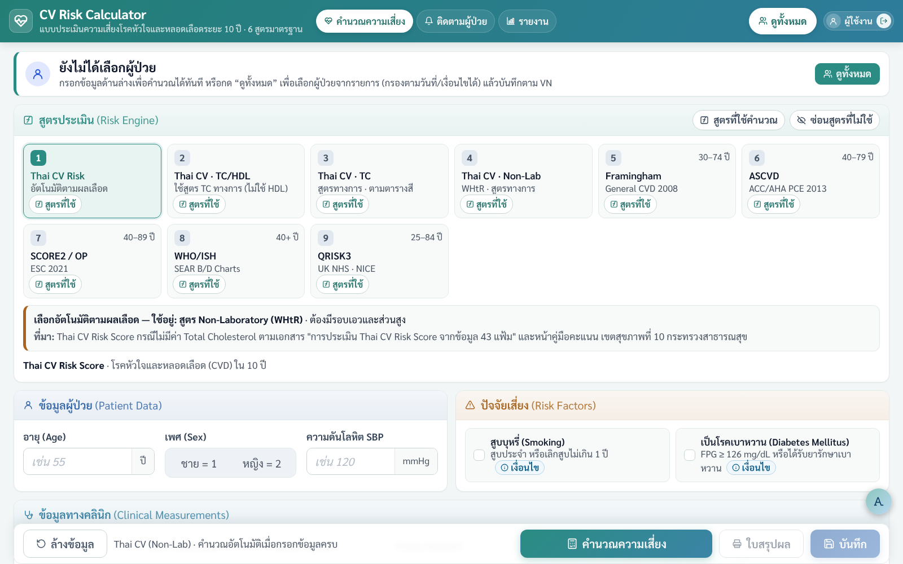
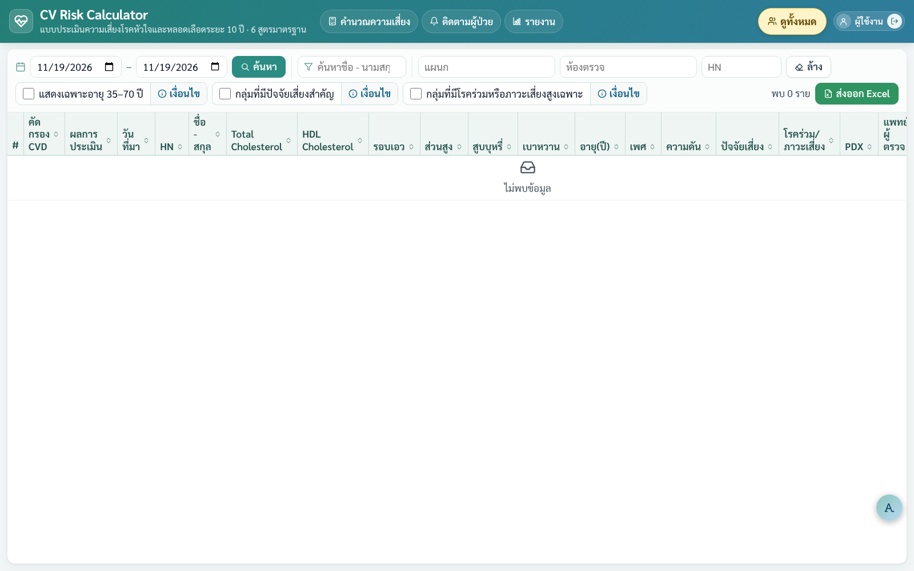
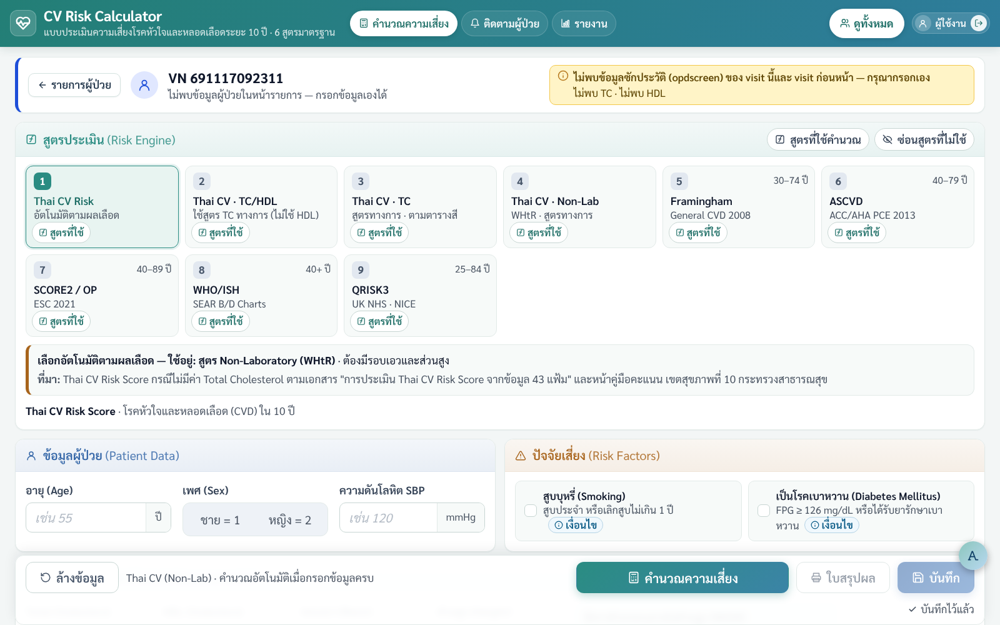

# CV Risk Calculator สำหรับ HOSxP

แบบประเมินความเสี่ยงโรคหัวใจและหลอดเลือดในระยะ 10 ปี (Thai CV Risk Score และสูตรมาตรฐานอื่น) ที่เชื่อมกับฐานข้อมูล HOSxP / HOSxP XE ใช้ได้ทั้งแบบเปิดตรงจากเครื่อง และแบบเปิดผ่าน HOSxP XE ด้วยลิงก์ `?bms-session-id=…`



## ความสามารถ

- **หน้าคำนวณเป็นหน้าแรก:** มี 9 สูตร ได้แก่ Thai CV Risk (อัตโนมัติ, TC/HDL, TC, Non-Lab), Framingham, ASCVD, SCORE2/OP, WHO/ISH และ QRISK3
- **ดึงข้อมูลอัตโนมัติจาก HOSxP:** อายุ เพศ SBP น้ำหนัก ส่วนสูง รอบเอว (opdscreen), TC/HDL (lab), การสูบบุหรี่ และเบาหวาน (ICD-10 / ยา / FBS)
- **บันทึกผลลง `opdscreen_cvd`:** ผลจึงไปอยู่ในเวชระเบียนและรายงานมาตรฐานของ HOSxP
- **ปุ่ม "ดูทั้งหมด" (มุมขวาบน):** เปิดรายการผู้ป่วย กรองตามวันที่ ชื่อ แผนก ห้องตรวจ HN อายุ 35–70 ปี กลุ่มปัจจัยเสี่ยง หรือโรคร่วม และส่งออก Excel ได้
- **ติดตามผู้ป่วย:** เสี่ยงสูงแต่ยังไม่ได้ statin, ครบ 1 ปีแล้วยังไม่ประเมินซ้ำ, ความดัน/LDL ยังคุมไม่ได้, ขาดนัด
- **รายงาน:** สรุประดับความเสี่ยงและความครอบคลุมตามอายุ พื้นที่ และหน่วยบริการ

| ดูทั้งหมด (รายการผู้ป่วย + ตัวกรอง) | ประเมินรายผู้ป่วยตาม VN |
|---|---|
|  |  |

## ติดตั้ง

1. ดาวน์โหลด [`CVD_Risk_Calculator-Setup-1.0.1.exe`](https://github.com/totobut0677-ai/cvd-risk-calculator/raw/main/dist/CVD_Risk_Calculator-Setup-1.0.1.exe) (ไฟล์ทั้งหมดอยู่ในโฟลเดอร์ [`dist/`](dist) พร้อม `SHA256SUMS.txt`)
2. ติดตั้ง (ติดตั้งรายผู้ใช้ที่ `%LOCALAPPDATA%\Programs\CVD Risk Calculator` ไม่ต้องใช้สิทธิ์ Admin)
3. เปิด **CV Risk Calculator** ครั้งแรกแล้วตั้งค่าการเชื่อมต่อฐานข้อมูล HOSxP (รองรับ PostgreSQL และ MySQL)
   - ค่าตั้งและ log เก็บที่ `%APPDATA%\CVD Risk Calculator\` (`config.json`, `server.log`) ติดตั้งใหม่ค่าตั้งไม่หาย

### เปิดจาก HOSxP XE

แอปรันเซิร์ฟเวอร์ภายในเครื่องที่พอร์ต **4009** ให้ตั้งเมนูหรือลิงก์ใน HOSxP XE เป็น

```
http://localhost:4009/?bms-session-id={session_id}
```

ระบบจะเข้าสู่ระบบอัตโนมัติด้วย session ของ HOSxP เปิดจากเครื่องอื่นใน LAN ได้ด้วย IP ของเครื่องที่ติดตั้ง (`http://<ip>:4009/...`) ส่วน API ข้อมูลรับเฉพาะคำขอจากเครื่องตัวเอง

### อัปเดตเฉพาะหน้าเว็บ (ไม่ต้องติดตั้งใหม่)

แตก [`dist/CVD_web_patch-1.0.1.zip`](dist/CVD_web_patch-1.0.1.zip) แล้วนำไฟล์ใน `web\assets\` ไปทับที่ `%LOCALAPPDATA%\Programs\CVD Risk Calculator\web\assets\` จากนั้นรีเฟรชหน้าแอป

## โครงสร้าง repository

```
app/
  server.cjs          เซิร์ฟเวอร์ข้อมูล (Node.js, bundle รวม dependency แล้ว)
  launcher.vbs        เปิดเซิร์ฟเวอร์แบบซ่อนหน้าต่าง และเปิดแอป (พอร์ต 4009)
  cvd.ico
  web/                หน้าเว็บที่ build แล้ว (Vite + React) router แบบ hash
  runtime/            ต้องมี cvdrisk-server.exe (Node.js runtime) ซึ่งอยู่ในตัวติดตั้ง ไม่ได้เก็บใน repo
docs/screenshots/
dist/                 ตัวติดตั้ง .exe, แพตช์หน้าเว็บ และ SHA256SUMS.txt
```

### เส้นทางหน้าในแอป

| เส้นทาง | หน้า |
|---|---|
| `#/` | หน้าคำนวณ (หน้าแรก) |
| `#/patients` | รายการผู้ป่วยทั้งหมด พร้อมตัวกรอง (ปุ่ม "ดูทั้งหมด") |
| `#/assess?vn=…` | ประเมินรายผู้ป่วยตาม VN |
| `#/follow-up` | ติดตามผู้ป่วย |
| `#/report` | รายงาน |

## ความต้องการของระบบ

- Windows 10/11 64 บิต
- ฐานข้อมูล HOSxP (PostgreSQL หรือ MySQL) ที่เครื่องเข้าถึงได้

## สัญญาอนุญาต

Node.js runtime ใช้สัญญาอนุญาตตาม `app/runtime/NODE-LICENSE.txt`
